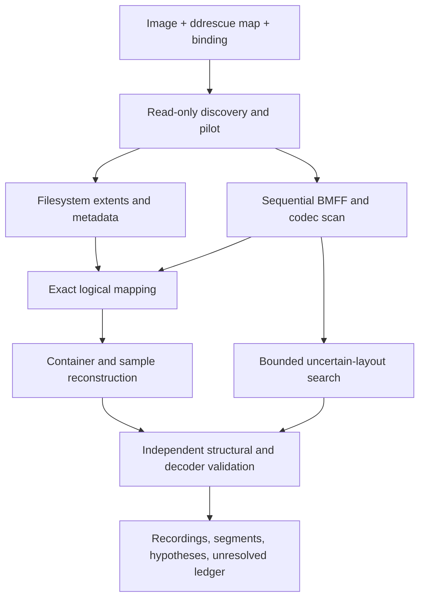

# Image-first video restoration: greenfield design

Status: proposed design, 2026-11-09. This document specifies a new system; it does not describe, assess, or reuse the current implementation. No implementation or recovery run is authorized by this document.

Companion documents: [evidence assessment](EVIDENCE.md), [Consensus research](CONSENSUS_RESEARCH.md), and [ordered implementation plan](IMPLEMENTATION_PLAN.md). Source keys such as E1 refer to the evidence assessment. Numerical limits below are proposed engineering defaults and acceptance targets, not measured performance or literature results.

## 1. Decision and intended outcome

Build a read-only, image-first recovery engine for the user's **primarily `.mp4` workload**, spending most effort on surviving filesystem and MP4 container metadata. Ordinary MP4 is the first release and evaluation priority. Recover provable layouts first; spend a fixed residual budget on uncertain layouts; publish independently useful, clearly qualified segments when a whole recording cannot be established. The product must remain useful when original `moov` metadata, filesystem chains, or some disk regions are missing.

The mandatory inputs are raw ddrescue disk image files. Associated mapfiles are available and must be incorporated. Image capacity, source filesystem, damage pattern, recording devices, target machine, and destination storage are discovery inputs; the user's time limit is 24 hours per image. V1 prioritizes ordinary ISO BMFF/MP4 with AVC/H.264, HEVC/H.265, and supported audio, then ISO fragmented MP4 profiles. Raw Annex B AVC/HEVC recovery is a secondary optional extension; it does not define or block the MP4 release. Support is certified by tested profiles, not implied by file extensions. An intact donor/reference clip is optional; it is not another required input.

Two meanings of “fragmented” must remain explicit. A **filesystem-fragmented MP4** has noncontiguous disk clusters/extents and may be an ordinary `moov`/`mdat` file. **ISO fragmented MP4 (fMP4)** uses movie fragments such as `moof`/`traf`/`trun`, regardless of whether its disk allocation is contiguous. Filesystem fragmentation alone is not evidence that a file uses fMP4. Success on raw video, DVR-specific layouts, or other carving formats does not directly validate this MP4 workload.

“Restoration” here means recovering original encoded video and defensible playback structure. It does not mean generating missing frames, enhancing appearance, interpolating motion, or disguising gaps. A useful consumer result can be a complete recording, an ordered set of recovered intervals with gaps, or several playable segments whose relationship remains unknown.

| Approach | Role in this design | Cost and accuracy tradeoff |
| --- | --- | --- |
| Filesystem-led logical file reconstruction | First choice for allocated files and surviving deleted-file metadata | Often converts a disk-sized search into direct extent reads; stale or reused metadata still requires qualification |
| Intact container recovery and relocation | Second choice where complete container layout survives | Exact logical offsets can be reused only after mapping them to image locations |
| Fragmented MP4 recovery | Recover initialization data and independently evidenced fragment runs | Good salvage opportunities; matching track IDs or timestamps alone cannot establish recording identity |
| Metadata-aided sample reconstruction | Use surviving sample tables and independently supported placement constraints | Can preserve exact samples; codec parsing cannot recreate all absent table information |
| Bounded unknown-layout search | Last resort for a small candidate set | Produces hypotheses or isolated segments; search limits are explicit |
| Unrestricted global fragment permutation | Excluded | Combinatorial cost and false joins make it unsuitable for the time and accuracy objective |

The expected improvement comes from doing less speculative work: direct extents, sequential scans, reusable indexes, early exact exports, and strict termination budgets. No general claim of reducing weeks to hours is justified before a representative pilot.

The [evidence assessment](EVIDENCE.md) separates MP4 container structure, reported MP4 carving methods, and reference-based repair from generic carving or raw/DVR results. These address different failure modes and do not establish measured end-to-end recovery of these images, exact original sequencing, or a 24-hour guarantee. The damage matrix and release gates below are proposed engineering requirements to be tested on an MP4-specific corpus.

## 2. Claims and product labels

Every output carries independent claims. A single “confidence score” must not blend them.

| Claim | Allowed states | What establishes it |
| --- | --- | --- |
| Byte and provenance certainty | acquisition-supported; synthesized; unavailable; binding-unverified | Image/map binding, exact source spans, hashes, and recorded transformations |
| Physical ownership | metadata-supported owner; shared geometry; historical conflict; unresolved | Filesystem/file identity evidence kept separately from equal byte content |
| Container structure | valid; repaired with recorded edits; invalid; untested | Bounded parser checks and complete accounting of referenced samples/boxes |
| Decoder result | strict-pass; failure; untested | An isolated, configured decoder run over the complete exported interval |
| Temporal correctness | original-mapping-supported; constrained-hypothesis; unresolved | Surviving logical layout/timing evidence or clearly weaker inference |
| Coverage | complete-within-known-layout; known-gaps; unknown-total | An explicit denominator and evidence about the original recording extent |

`strict-pass` does not upgrade temporal correctness or coverage. Correctly decoded frames can be in the wrong order, belong to a different recording, or omit large intervals. A file may have exact source bytes yet unresolved physical ownership because the same content appears in multiple places.

The default result view separates:

1. **Recovered recordings:** original layout and timeline supported by surviving metadata; any repaired container bytes are enumerated.
2. **Recovered segments:** self-contained playable intervals; gaps and unknown relationships remain visible.
3. **Provisional sequences:** a bounded alternative ordering for review; never silently presented as the original recording.
4. **Unresolved material:** candidate bytes, missing initialization data, ambiguous ownership, or exhausted search budgets.

“Complete” always names its scope. For example, “all samples listed in this surviving table recovered” is narrower than “all recordings once stored on this disk recovered.” The latter is generally unknowable after deletion and overwrite.

## 3. Input contract and immutable source

### 3.1 Image and map binding

GNU ddrescue map positions use input coordinates. Map `+` intervals are finished; `?`, `*`, `/`, and `-` intervals are not finished. Output relocation requires the original input/output position difference. A mapfile does not authenticate its image. [E1](EVIDENCE.md#e1-gnu-ddrescue)

Normalize acquisition input before any filesystem or codec inference:

```text
image_offset = acquisition_input_offset + (output_position - input_position)
image_offset = filesystem_start_in_image + filesystem_relative_extent_offset
original_device_offset = original_partition_start + filesystem_relative_extent_offset
```

The third coordinate is optional when the original partition start is unknown; a partition image can still be processed in its established local coordinate system. The mapping may be piecewise if acquisition copied multiple domains into one destination. Record each transformation explicitly; never guess a zero offset from plausible file signatures. Map intervals outside the image, overlaps, integer overflow, conflicting map generations, and unknown relocation block trustworthy acquisition claims until resolved. Map gaps and areas outside its rescue domain are `unknown`.

The engine opens image files read-only and never modifies mapfiles. It does not mount images read-write or launch a rescue command. Work and outputs live on a separate writable destination outside source paths. Discovery reports whether the work destination shares a physical device with image storage because that affects scheduling and free space.

Each read returns bytes and an interval-level quality mask. Bytes in non-finished/unknown acquisition regions are unavailable by default even if the destination contains nonzero bytes or plausible media. Old destination content must not become recovered evidence. A filesystem sparse extent with supported logical zero semantics is distinct from a hole created by incomplete acquisition. Zero bytes alone cannot identify either.

### 3.2 Source identity

A source manifest records image size, file identity, access mode, map digest, coordinate mappings, partition hypotheses, acquisition notes, and content fingerprints from consumed ranges. A full image digest is accumulated during a complete scan when one is needed; an extra mandatory full-disk hashing pass must not delay first recovery.

A few sampled hashes plus unchanged mtime are change detectors, not proof that all unobserved bytes stayed unchanged. Strong resume reuses a stable read-only snapshot identity where available, or verifies the stored hashes of all ranges used by reused results. Any conflicting range creates a new source generation and invalidates dependent results. An incomplete scan has a partial-hash claim, never a fabricated full-image identity.

The user may supply multiple images or acquisition generations later. Their coordinate systems and evidence remain separate. A successful region from one image is not substituted into another without an explicit merge operation, overlap comparison, and new provenance manifest.

### 3.3 Observed input family and recovery budget

The bounded read-only inventory in [IMAGE_INVENTORY.json](IMAGE_INVENTORY.json) identifies eight raw partition images totaling 1,253,697,155,072 bytes: four 250,147,241,984-byte exFAT images and four 63,277,046,784-byte FAT32 images. Boot metadata indicates 128 KiB exFAT clusters and 16 KiB FAT32 clusters, respectively. The paired maps declare one finished interval covering each image; this removes declared acquisition holes from these supplied maps, not filesystem damage, overwrite, missing metadata, or image/map pairing uncertainty. Boot geometry remains a hypothesis until filesystem consistency checks pass.

FAT32 and exFAT are therefore the first implementation targets. The shared exFAT volume serial is a possible acquisition-family clue; differing boot hashes and unknown epochs prevent an identical-content conclusion. Each image stays an independent source generation. Cross-image reuse requires byte verification and explicit scope; it cannot silently assemble recordings across snapshots.

The bounded [FILESYSTEM_PROBE.json](FILESYSTEM_PROBE.json) records successful read-only filesystem opens with installed Sleuth Kit 4.14.0 on representative images, with recognizable root directory entries. This makes metadata-first recovery a concrete discovery path; it does not prove the remaining chains or media valid. An exFAT boot field retains an original partition offset of 2,048 sectors while the filesystem starts at image byte zero. The adapter must use the established image coordinate transform and must not add that historical partition offset a second time.

The bounded [DIRECTORY_PROBE.json](DIRECTORY_PROBE.json) observes `.mp4` and `.h265` names in one representative FAT32 recording directory, including deleted entries. [FILE_ENTRY_PROBE.json](FILE_ENTRY_PROBE.json) reports the inspected `.h265` entry has size zero; no elementary payload is thereby established. A nominal deleted MP4 size and its first few sectors likewise do not establish complete recovery. Names nominate profiles; header/bitstream validation must determine actual formats. The user's MP4-primary requirement controls V1 priority; a `.h265` name does not make raw-stream recovery coequal. An empty nonrecursive backup-directory listing is not evidence of a usable backup.

The inspected destination volume has about 454 GiB free at inventory time, less than the combined image bytes. Re-exporting all images or every alternative is not a viable default. Use logical extent views, duplicate-aware manifests, per-case/index/output quotas, selective materialization, and fresh free-space checks; do not assume that copied-image size equals recoverable-video size.

The user permits up to **24 hours per image**. This cumulative processing-wall budget includes intake, indexing, matching, full validation, export, and checkpoint/shutdown reserve; paused time is separately reported and does not reset consumed budget. There is no extra uncounted recovery phase. Preflight must expose an I/O floor that makes the chosen scope impossible within that limit. Budget expiry publishes secured results, checkpoints remaining work, and reports partial/unresolved coverage. A later authorized continuation resumes the same case without rescanning every completed range merely to rebuild indexes.

Per-image feasibility is distinct from the whole acquisition family. Eight serial runs each consuming their allowance could occupy eight days; that is a budget maximum, not an ETA. A family dashboard must report cumulative work, duplicate/redundant-image opportunities, chosen image priority, and remaining total scope. It must never imply that all eight images are guaranteed complete within one 24-hour period.

## 4. Architecture and pass order

The recommended implementation is a Rust core with a small conventional CLI and local desktop interface over the same job API. Rust provides explicit byte bounds, checked arithmetic, efficient streaming, and predictable concurrency for hostile binary input. The choice is a design recommendation, not an obligation to alter the current repository. Use mature filesystem tooling behind a narrow adapter before writing new filesystem recovery parsers. Use FFmpeg for independent decoding/remuxing, not as the authority for original file identity.

Native filesystem/media libraries remain hostile-input boundaries: Rust does not make their C parsers memory-safe. Run those adapters/decoders in resource-bounded helper processes, translate crashes into scoped failures, and route their source reads through controlled range/quality accounting. Pin headers/binaries together; the observed TSK 4.14.0 installation must not be implemented against older online API documentation without checking the installed ABI.

SQLite stores durable semantic state and receipts. Large immutable indexes are versioned, sorted binary files with bounded windows or memory mapping; SQLite stores their manifests, ranges, and checksums. Avoid one database row per sector, NAL marker, or byte.



The order is progressive:

1. Discover acquisition and filesystem geometry; run a bounded representative pilot.
2. Recover directly addressable files and their metadata, including useful deleted extents.
3. Scan only residual/unaccounted ranges for container candidates, with configurable full-image coverage where metadata is insufficient.
4. Reconstruct containers from exact tables and mapped sample extents.
5. Recover evidenced fragmented runs and isolated independently decodable intervals.
6. Search only within explicit, bounded candidate neighborhoods for missing layout.
7. Validate and publish useful results continuously; report residual unknowns at every stop.

Passing a stage does not erase alternatives. A file recovered from stale metadata may coexist with a competing physical ownership hypothesis. The ledger records both without duplicating identical geometry or claiming exclusive ownership.

## 5. Filesystem-led recovery

A filesystem adapter emits partition geometry, file identities, named streams, allocated/deleted state, logical-to-physical extent runs, sparse/uninitialized flags, allocation evidence, and parser limitations. Sleuth Kit is a candidate read-only extraction backend with filesystem/image APIs and deleted-file analysis; each supported filesystem/profile needs its own certified behavior. [E2](EVIDENCE.md#e2-filesystem-evidence)

The adapter must distinguish metadata-supported extents from library recovery/contiguous-placement guesses. A backend's recovered file walk is not automatically exact. Emit its recovery flags and the actual FAT/extent evidence; guessed placement remains a hypothesis. Normalize callback addresses/lengths with explicitly recorded units (bytes, sectors, or clusters) using the backend's verified unit size. Never multiply an address by cluster size merely because the filesystem uses clusters. Damaged-acquisition profiles require accounting for the metadata bytes consumed by native parsers, not only the returned file extents.

The engine uses surviving allocation metadata as evidence, not as an authenticity oracle:

| Filesystem condition | Action |
| --- | --- |
| Allocated file with consistent extent map | Read its logical view directly; intersect every extent with acquisition quality |
| Deleted file with surviving extent map/chain | Recover referenced bytes; detect current allocations and contradictory reuse; qualify stale metadata |
| Deleted chain partly lost | Keep known runs; create bounded placement hypotheses only for missing runs |
| Sparse or uninitialized logical range | Follow certified filesystem semantics and label synthesized zeros |
| Cross-linked extents or clones | Retain all owner references to the same physical geometry; do not invent exclusive ownership |
| Damaged metadata or unknown filesystem | Fall back to residual scanning; expose limitations |
| Encrypted volume without usable keys | Identify the barrier; do not scan ciphertext as if codecs can recover it |

Initial support should be selected after input discovery. FAT32/exFAT, NTFS, ext4, and APFS differ substantially. For FAT-family deletion, intact contiguous assumptions, surviving chain entries, exFAT contiguous-file metadata, and allocation bitmap evidence must remain separate cases. Do not assume that deletion always erases every chain or always preserves it. APFS clone/snapshot/compression/encryption behavior requires a specifically validated adapter; generic “filesystem support” is insufficient.

For exFAT, `NoFatChain=1` describes contiguous allocation and makes the corresponding FAT chain entries invalid to follow; current allocation is tracked by the allocation bitmap. Deleted entries can be stale. Those rules are explicit adapter invariants, not generic FAT assumptions. [E6](EVIDENCE.md#e6-exfat-specification)

A raw logical file reconstructed from extents remains a view until export is worthwhile. Parsing scattered extents through `RangeSource` avoids copying every candidate file before its usefulness is known. Small metadata and source-span manifests can be exported early. Whole-file output is reserved for files that pass the relevant gates.

Filesystem fragmentation can split an MP4 chunk, a sample, or even a NAL length prefix. Container chunks are logical groups, not guarantees of physical contiguity. With valid metadata, compose the ordered cluster/extents into a logical reader before parsing. With missing chains, continuation matching must consider cluster-boundary splits, including partial headers; it must not assume that an entire sample occupies one contiguous physical run. Candidate cluster successors remain bounded and qualified.

## 6. Container and codec reconstruction

### 6.0 MP4 damage decision matrix

Use this matrix to route work before spending a speculative budget. “Extents intact” means an evidenced logical file mapping, not merely a backend's recovery guess. Every path retains the separate byte, ownership, structural/decode, temporal, and coverage claims. Acquisition availability still applies in every row.

“Exact” describes determined snapshot bytes/layout under the declared target evidence; it cannot authenticate pre-damage content when sectors were silently reused and no original digest survives. Historical content/ownership uncertainty must remain visible even if replacement bytes happen to decode.

| MP4 condition | Proposed recovery path | Defensible result and limit |
| --- | --- | --- |
| Ordinary MP4; extent map and `moov`/tables/media intact | Read the logical file directly, including cluster splits; validate the actual result | Original file bytes if exported unchanged, or encoded-sample-preserving remux with recorded metadata edits; original order/timing only where supported by the target's tables |
| Ordinary MP4; extent map intact; `moov`/tables intact; some `mdat` bytes absent or overwritten | Resolve listed samples, mark missing payload, propagate reference dependencies, and split at safe supported boundaries | Exact surviving sample bytes and supported timeline intervals; known missing samples/gaps, not a complete recording |
| Ordinary MP4; extent map damaged; usable `moov`/tables survive | Use table sizes/logical offsets/timing as constraints for bounded cluster/extent placement; distinguish metadata-backed placement from hypotheses | Exactness only for independently established placement; equal-length candidate payloads and successful decode do not prove original ownership/order |
| Ordinary MP4; extent map intact; `moov` missing or partly damaged | Retain known logical payload order; use surviving target tables/configuration first; optionally use a compatible reference for configuration/priors; attempt only supported bounded access-unit/sample salvage | Missing sample boundaries, DTS/PTS, duration, track interleaving, edits, or audio configuration may remain unresolved. A playable rebuilt container can still have inferred timing/segmentation |
| Ordinary MP4; both extent map and `moov` materially missing | Search only constrained target anchors within the declared budget; preserve independently supported intervals and alternatives | High ambiguity; no guaranteed whole-file reconstruction. Return qualified segments or unresolved bytes instead of assembling a plausible complete movie |
| fMP4; initialization and evidenced fragment membership/placement survive | Resolve fragment defaults/addressing and timing; validate each supported run | Target-supported sample sequence, timing, and explicit gaps; repeated fragment IDs/counters alone do not establish membership |
| fMP4; initialization missing or some `moof`/payload fragments lost | Recover supported isolated runs; use surviving target configuration or an optional reference with recorded assumptions | Missing initialization may prevent decode; missing fragments cause gaps. Reference metadata cannot supply the original missing fragment sequence/timestamps |

For ordinary MP4, physical adjacency does not imply track adjacency: audio/video samples may be interleaved, a logical MP4 chunk can cross filesystem clusters, and a sample can span multiple extents. Decode order differs from presentation order with B frames; VFR and composition offsets prevent replacement by a guessed constant frame rate. Audio packet boundaries and synchronization need their own target evidence. If these facts are absent, preserve uncertainty rather than repairing it invisibly.

### 6.1 Bounded parser

The BMFF parser uses checked 64-bit offsets and lengths, bounded recursion, box-count limits, parent containment, profile-specific required fields, and streaming payload reads. It handles 32-bit sizes, extended sizes, and legal end-of-parent forms. A header hit is a candidate, not a file. Require coherent box topology and supported sample references before accepting it.

Scan tiles retain enough overlap to detect headers crossing tile boundaries. Large boxes are represented by ranges, never buffered whole. Candidate nesting and duplicate discovery paths are canonicalized by physical geometry. Unsupported or malformed boxes are recorded and skipped within bounds; they must not trigger unbounded recursion or speculative resynchronization.

### 6.2 Exact sample tables

For ordinary MP4, surviving tables describe sample sizes, chunk membership/offsets, decode timing, composition timing, and access information. These fields serve different purposes; one table cannot replace the others. [E3](EVIDENCE.md#e3-iso-bmff-sample-layout)

Reconstruction builds an explicit logical sample map using surviving `stsd`, `stsz`/`stz2`, `stsc`, `stco`/`co64`, `stts`, `ctts`, and applicable sync/dependency/edit information. Validate counts, integer ranges, table consistency, duration calculations, data references, chunk containment, overlap, and complete byte accounting. Reject unsupported external data references for automatic reconstruction.

Those tables contain sizes, placement, and timing—not hashes of the original payload. A length signature is often low entropy and cannot uniquely identify a recording. Content anchors must come from actually observed, attributed bytes; unobserved expected sample bytes cannot be conjured from metadata.

Chunk offsets are logical file offsets. They become image offsets only through the recovered filesystem view or separately evidenced placement transform. Treating `stco` as a physical disk offset would be a correctness defect. A single relocation base is valid only for independently supported contiguous placement; fragmented placement requires an extent map or explicit piecewise hypothesis.

If sample tables survive but media ranges are incomplete, mark each missing sample and its dependency effects. Export intact dependency-safe intervals. Rebuilt headers/tables are synthesized bytes with a transformation receipt; encoded sample bytes remain byte-preserved. Preserve original time values in the manifest when playable exports normalize timestamps.

### 6.3 Fragmented MP4

Parse initialization metadata and fragment defaults/overrides, including `mvex`/`trex`, `moof`/`traf`, `tfhd`, optional timing boxes, `trun`, and their data addressing semantics. The W3C MSE document is useful for its specific fragmented MP4 profile; its restrictions must not be imposed on all ISO BMFF. [E4](EVIDENCE.md#e4-fragmented-mp4-profile)

Resolve data offsets using the actual supported file/profile rules, not a universal “mdat immediately follows moof” assumption. Retain raw offsets and timing fields as evidence. A standalone `moof` may lack enough initialization, codec configuration, or placement context to be decodable.

Join fragments automatically only when a shared logical file view or other independent provenance establishes membership and ordering. Track IDs, `mfhd` sequence numbers, `tfdt`, codec configuration, and duration continuity are useful constraints, but repeated/reset values across recordings prevent them from proving identity alone. A gap does not authorize filling a timeline with unrelated fragments having matching timestamps.

### 6.4 Codec-aware salvage

The codec layer parses enough AVC/HEVC syntax to validate configuration, NAL length framing, access-unit candidates, random access, reference requirements, and timing constraints where present. Respect the configuration-declared NAL prefix width and profile restrictions instead of assuming every length is four bytes. Handle supported in-band parameter-set sample entries such as `avc3`/`hev1` and out-of-band configurations according to their own rules. Length-prefixed MP4 NALs and Annex B start codes are different representations; conversion is explicit and recorded.

IDR, CRA, leading-picture, open-GOP, parameter-set changes, POC wrap/reset, B-frame reordering, and missing references must be evaluated under the supported codec profile. In particular, an HEVC CRA is not treated as universally equivalent to an independent IDR boundary. Codec continuity is a rejection filter and partial-order constraint; it is insufficient proof of original absolute timeline or recording identity.

Raw AAC carried in MP4 may have no ADTS framing. Without trustworthy sample sizes and configuration, audio boundaries and synchronization can remain unresolved. Do not fabricate audio joins. Publish video-only segments, separate audio with explicit timing uncertainty, or raw candidate spans when that is the truthful result. Apply equivalent caution to unsupported audio formats.

An optional intact reference clip can supply candidate codec configuration or device layout priors. It cannot prove the target clip's sample sizes, timestamps, physical placement, duration, or content identity. Reference-conditioned output remains qualified when the target's own evidence does not establish those facts.

Do not copy a donor's `moov` wholesale and call the target restored. Its chunk offsets, sample counts/sizes, interleaving, DTS/PTS, edit lists, and duration belong to the donor. Codec/NAL headers likewise do not recreate missing original MP4 sample tables or audio timing. A supported reconstruction generates only fields justified by target observations or explicitly labeled assumptions, and validates those claims against the target bytes. Without an optional reference, the same decision matrix still runs and returns narrower salvage or unresolved results when configuration cannot be established.

### 6.5 Optional raw elementary streams

This is a secondary capability after the MP4-primary release gates. It is enabled only for a selected or confirmed raw-stream scope and does not consume the MP4 run's budget by default.

For a filesystem-backed `.h265`/AVC candidate, preserve its exact logical byte sequence through the recovered extent map, then identify Annex B framing, parameter sets, access units, and supported dependency-safe segments. A container-free stream may lack original timestamps, frame rate, audio, and original recording boundaries even when every observed byte is recovered. Distinguish observed codec timing from an inferred playback rate; any remuxed synthetic timeline is explicitly provisional. A raw stream is not forced into an MP4 sample-table model.

Residual elementary-stream carving uses the same bounded cluster-continuation and ownership rules. Start-code hits alone do not establish a complete recording; arbitrary loss can split start codes, NAL units, and reference chains. Preserve verified segments and unresolved gaps rather than claiming original duration from decoded frame count times a guessed rate.

## 7. Bounded matching for missing layout

### 7.1 Search eligibility

Start with a known recording anchor or a strongly structured segment. Generate candidates from locality, filesystem residual runs, exact sample-size constraints, container data references, codec configuration compatibility, and supported dependency boundaries. Use similarity/scene continuity only as a low-weight reviewer aid. Never choose a join solely because it looks smooth or decodes.

Each candidate edge records independent supporting and contradicting evidence. Hard contradictions reject it: unavailable source bytes, impossible sample length, incompatible initialization, invalid reference state, impossible logical offset, or overlapping physical spans inconsistent with the asserted layout. Repeated frame content is not a contradiction by itself and is not evidence of unique physical ownership.

Candidate ranking orders work; ranking is not an accuracy claim. Unless original mapping is independently established, even the highest-ranked single surviving hypothesis remains a hypothesis. If multiple alternatives cannot be distinguished, default export ends before the ambiguous boundary and retains the alternatives for review.

### 7.2 Canonicalization before joining

Use three distinct identities:

1. **Geometry identity:** canonical ordered physical source spans and quality generation. Deduplicate this before candidate expansion.
2. **Content equivalence class:** strong digest plus verified byte equality where identity matters. Store a posting set of all physical locations.
3. **Logical ownership hypothesis:** file/recording membership and timeline evidence. Identical content never collapses different owners into one proven identity.

Compare unique geometry/content classes first. Carry physical alternatives as compressed postings until evidence actually disambiguates them. Do not form a Cartesian product of every duplicate source location and every sample occurrence. Prefix signatures or rolling fingerprints are filters; they do not establish exact equality.

Retrieval itself is bounded. Build selective access paths over configuration class, observed length/boundary constraints, supported timing keys, and ordered physical offsets where those fields exist. Store bucket cardinality/skew summaries during index construction. A query uses a declared range/order and the most selective available key; it cannot scan a whole hot bucket merely to return eight edges. The initial unknown-layout locality window is ±256 MiB around its supported anchor, recorded as a search limitation rather than a physical truth. Queries lacking a useful discriminator return a compact high-collision/unresolved result.

Cap each query at 4,096 visited postings and 1 MiB of index bytes, with cumulative visited-posting, byte, and CPU counters charged to the anchor and total budgets. Cache compact hot-bucket outcomes by index generation and semantic constraints so repeated beam states do not rescan the same oversized bucket. Resume persists relevant query cursors/cutoffs. Stronger later evidence may open a new selective query; it does not make the earlier bounded query exhaustive.

### 7.3 Explicit search limits

Initial configurable defaults:

| Resource | Default budget | Behavior at limit |
| --- | --- | --- |
| Candidate postings expanded for one weak signature | 128 distinct geometry classes | Mark high-collision; require a stronger discriminator or retain unresolved posting set |
| Index query work | 4,096 visited postings and 1 MiB index bytes per query | Stop retrieval with a cursor/cutoff receipt; repeated states reuse compact outcomes |
| Retained search states per anchor | 16, with at most eight materialized successors per state | Keep ranked frontier plus cutoff receipt; never claim exhaustive search |
| Full candidate transitions tested per anchor | 50,000 | Checkpoint and finish anchor as `budget_exhausted` |
| Speculative work per anchor | 120 wall seconds, 64 MiB read bytes, and 60 seconds of decoder probes | Whichever budget expires first terminates the attempt |
| Total speculative phase | Smaller of two hours and 20% of chosen elapsed-time budget | Preserve time for validation and useful exports within the 24-hour total |

These are starting controls for benchmarking, not scientifically validated thresholds. Exact metadata-led paths do not lose correctness because a speculative beam was truncated. An anchor with a large legitimate candidate set becomes unresolved; it does not inherit a false “no match exists” label.

Deterministic state keys include source generation, physical span sequence, initialization identity, logical sample cursor, and timing/dependency state. Transposition pruning applies only to semantically identical states. Serialize the compact frontier, counters, tested-edge keys, and cutoffs. Resuming an unchanged budget adopts completed work; increasing a budget continues the same evidence space without pretending earlier search was exhaustive.

## 8. Independent validation and publication

Validation has separate stages:

1. Re-read or verify referenced source span hashes and acquisition masks.
2. Independently reparse the actual staged artifact, not only its plan. Stream its encoded samples and compare per-track sample ordinal, payload hash, size, supported timing transform, and configuration against the source `SampleMap`; check structure, table math, and physical mapping. For raw streams without container timing, compare the planned ordered spans and observed NAL/access-unit hashes/configuration while keeping absent timing unknown. A validly decoding writer/remux error is still a failure.
3. Decode the entire exported interval with strict settings; capture machine-readable packet/frame counts, timestamp discontinuities, warnings, errors, decoder version, and command arguments.
4. Check temporal evidence against the reconstruction manifest, independently of decoding.
5. Compute coverage against known metadata or mark its denominator unknown.

FFmpeg strict error handling is a useful validation component; error-concealing/continue-on-error settings cannot be used to qualify strict outputs. Decoder success remains a limited result. [E5](EVIDENCE.md#e5-independent-decoding)

The validator rejects decoding that hangs, exceeds resource bounds, or returns unsupported-profile ambiguity; it never silently treats a timeout as a pass. A separate permissive preview may aid inspection, with its status visible. Full validation can cost more than scanning; its measured throughput belongs in the ETA and budget.

Publication first flushes/fsyncs staged file contents or virtual-manifest bytes, then durably persists an intent and validated hashes/receipt, then renames staged files and flushes the destination directory, and finally commits the published ledger state. Filesystem renames and SQLite commits are not one atomic operation; a directory flush alone does not make file contents durable. Ordinary result enumeration uses committed publication records; restart reconciles interrupted names against durable intent. Never duplicate or silently adopt unverified outputs. Insufficient disk space pauses before publication, preserving completed work.

Encoded sample bytes are copied without transcoding. Remuxing may synthesize headers, normalize timestamps, or produce alternate containers only through an explicit transformation record. A framing conversion changes sample representation; it cannot retain a byte-identical-sample claim. Its declared reversible payload transform must be verified separately. Original extracted bytes and source spans remain traceable. An elementary stream that validates but cannot be safely muxed is still a qualified segment result.

### 8.1 Image-backed results and portable exports

An accepted result may be a small durable `VirtualArtifact` manifest consisting of ordered source spans, supported logical zeros, synthesized container bytes, and dependency hashes. It is an **image-backed result** that depends on unchanged source generations; it is not a portable standalone media file. Preview/validation opens that exact published manifest through a seekable `VirtualFileView`. Portable export materializes it once when requested and within its space budget.

The first implementation must either provide an isolated FFmpeg/libavformat AVIO read/seek bridge over the bounded view or materialize only the selected validation/export subset within quota. A sequential pipe cannot replace seekable input for arbitrary MP4. The AVIO bridge is a narrow read/seek adapter with all reads bounded to declared view pieces; it needs no FUSE driver, kernel extension, or whole-image copy. Qualify its behavior against materialized byte-identical controls before accepting virtual results. Independent final-artifact/sample comparison applies to the reopened manifest view as well as physical files.

## 9. Data model and component contracts

| Entity | Essential fields |
| --- | --- |
| `SourceGeneration` | immutable ID, image binding, map digest, coordinate transforms, source assertions, consumed-range hashes |
| `AcquisitionInterval` | input/image half-open ranges, status, evidence source; interval encoding rather than sector rows |
| `LogicalFileView` | filesystem identity, deletion/allocation evidence, ordered extent runs, logical size, ownership ambiguity |
| `Observation` | parser/version, source spans, observed metadata, structural checks, limitations |
| `SampleMap` | track/config identity, sample sizes/timing, span runs, missing regions, access/dependency facts |
| `CandidateClass` | geometry identity, exact-content class, compressed postings, constraint keys |
| `Hypothesis` | anchor, ordered span/sample refs, evidence and contradictions, frontier/cutoff state |
| `Artifact` | materialized file or virtual manifest, dependency/source hashes, transformations, independent claim fields, validation receipt |
| `WorkUnit` | stable semantic key, input generations, stage, attempts, budgets, checkpoint ref, terminal reason |

Minimum interfaces:

```text
RangeSource.read(range) -> bounded bytes + acquisition/semantic quality intervals
FilesystemAdapter.discover(source) -> geometry + supported capabilities + limitations
FilesystemAdapter.views() -> stream<LogicalFileView>
ContainerParser.inspect(view_or_ranges) -> observations + exact constraints
SampleMapper.resolve(observations, placement) -> SampleMap | explicit unresolved reasons
CandidateIndex.query(constraints, range, cursor, budget) -> classes + compact postings + visited-work/cutoff receipt
Assembler.advance(anchor, frontier, budget) -> hypotheses + segments + checkpoint
Validator.check(artifact, manifest) -> independent claims + reproducible receipt
Publisher.commit(staged_artifact, receipt) -> published ID | resumable failure
```

All ranges are half-open with checked offsets. Errors are typed: malformed, unsupported, acquisition-missing, binding-unverified, ambiguous, resource-limit, source-changed, decoder-failed, and I/O-failed. `not_found` requires a stated searched domain; budget termination is a different result.

Work states are `pending → running → checkpointed/validated → publishing → complete`, with `paused`, `cancelled`, `unresolved`, and `failed` carrying distinct reasons. Cancellation stops new work, drains or interrupts bounded tasks, and durably records the frontier. No completed artifact is lost because a later anchor fails.

## 10. Storage, memory, and scheduling bounds

### 10.1 Index sizing

Per-sector indexing is rejected. A 1 TiB image has 268,435,456 4 KiB positions; even 32 bytes per position consumes 8 GiB before database/index overhead. A 1 MiB tile summary at 24 bytes per tile consumes 24 MiB per TiB. Exact box/sample/range records are variable and must be estimated from measured density.

For a projected `N` records, record width `r`, sort factor `s`, and manifest overhead `m`, reserve `N × r × s + m`; include simultaneous old/new generations during compaction. A million candidate records at 48 bytes consume about 46 MiB before sort/index overhead. Repetitive payload can still produce far more records than expected; enforce total caps, not average-density assumptions.

Default work-index cap is the smaller of 20 GiB and 2% of image logical size, with an explicit free-space reserve and configurable override. Output storage is separate and may approach recovered unique byte volume; materializing multiple alternatives can multiply it. Reuse byte views during search and export alternatives only when requested. If the index cap truncates a domain, mark scan/search coverage incomplete. Do not discard evidence while claiming a complete inventory.

Small metadata, evidence manifests, and useful segments take priority over speculative copies. Checkpointing writes bounded event batches, compact frontier records, and changed index shards; it never copies multi-GiB indexes or media as a periodic “snapshot.” Keep the current frontier manifest and at most two historical frontier manifests by default, configurable to retain more. They share immutable index/media references rather than duplicate those payloads. Compact replay events into current semantic state while retaining final artifact, failure, and evidence receipts. Retain index generations required by current/history manifests or published artifacts; retire only unreferenced case-owned temporary generations under the configured quota. Compaction and its temporary space are budgeted and use an atomic generation swap.

### 10.2 Deterministic, storage-aware parallelism

One scheduler controls read concurrency. Start with one sequential scan stream per source physical device; coalesce adjacent reads and queue foreground exact exports between scan windows. Increase concurrency only when the pilot demonstrates improved throughput without unacceptable seek amplification. Source and destination sharing a drive reduces the default concurrency. CPU parsing, hashing, and decode queues remain bounded separately.

Stable work IDs and deterministic merge ordering give identical decisions, evidence labels, and artifacts for the same completed semantic work and logical byte/edge budgets, independent of thread completion order. Wall deadlines, hardware speed, and resume verification can change which work finishes before the cap; completed coverage and result counts may therefore differ. Record that preemption explicitly. Compare deterministic behavior at equal completed logical work, and test deadline-truncated partial results separately.

The initial managed-memory cap is `min(8 GiB, physical RAM / 4, currently available RAM / 2)`. Below 512 MiB available to the engine, restrict work to exact extraction or pause automatic search. Start with one decoder and up to eight CPU workers, initially limited to half the host's logical cores with a minimum of one. The pilot may raise concurrency when measured throughput, available cores, memory pressure, and source/destination I/O support it; eight/half-cores is a starting policy, not a permanent performance ceiling. Decoder processes have their own measured memory envelope included in the host budget. “Managed memory” excludes file cache, so acceptance must also measure resident memory and system pressure.

### 10.3 Pilot, ETA, and stop/continue gates

The pilot samples metadata regions plus deterministic distributed windows across the actual image. It also includes both sparse/low-density and high-density regions when observed; a front-of-disk sample is insufficient. Default pilot limits are 10 minutes or 8 GiB read, whichever occurs first, with a minimum viable sample reported when the device is slower. It must not suppress directly recoverable early files.

Measure effective sequential bandwidth, seek latency/read amplification, available work/output space, filesystem extent yield, candidate density/skew, parser bytes per CPU second, matcher transitions per second, decoder video-seconds per wall-second by profile, and checkpoint/resume cost.

For raw streams without an established timebase, measure decoded frames/access units or encoded bytes per wall-second. Estimate their validation cost in those observed units; do not manufacture a duration denominator from a guessed playback rate.

Let `R` be remaining bytes to scan, `B` measured effective scan bandwidth, `V` remaining video-seconds needing validation, `D` measured decode rate, and `S` bounded speculative allowance. For a shared storage/CPU resource, use a conservative sum rather than assuming perfect overlap:

```text
I/O floor = R / B
conservative estimate = scan + extraction + validation + speculative allowance + checkpoint overhead
```

Report a measured interval and assumptions, not a single invented completion time. For scale, a complete 1 TiB read at a sustained 100 MiB/s takes about 2.91 hours before extraction, validation, seeks, or retries. This arithmetic is not an estimate for the user's device.

For the observed larger images, one 250,147,241,984-byte pass at a sustained 100 MB/s takes about 41.7 minutes; a 63,277,046,784-byte pass takes about 10.5 minutes. These are scale illustrations, not measured rates. Multiple passes, seeks, all recovered recording durations, decoder profiles, and destination writes belong in the actual 24-hour estimate.

Before expensive continuation, the product reports: useful results already secured; projected additional recoverable material; remaining I/O floor; elapsed/remaining budget; speculative cost and ambiguity; disk headroom. At the 24-hour limit it checkpoints and produces the truthful result set. The user can authorize another bounded continuation, narrow targets, or stop. No destructive cleanup or external acquisition is automatic.

The coordinator reserves shutdown time and stops scheduling before the deadline. An operating-system uninterruptible I/O operation can overrun that target; report the condition and actual elapsed time rather than claiming an absolute kernel-level deadline guarantee.

## 11. User workflow

1. Select image(s), mapfile(s), work/output destination, and optional acquisition notes/reference clips.
2. Resolve binding/geometry problems with explicit evidence; read-only discovery shows supported filesystem and codec profiles.
3. Choose a total time/storage budget. The pilot returns measured feasibility and early exact results.
4. Run progressive recovery with counts for recordings, segments, hypotheses, unavailable bytes, and unresolved reasons.
5. Pause/cancel/resume through conventional controls. On restart, completed semantic work is adopted idempotently.
6. Review qualified outputs and gaps. Preview and export do not upgrade their evidence claims.
7. Save an auditable result package: playable outputs, manifests, coverage/search receipts, validation evidence, and remaining options.

Progress distinguishes scanned bytes, eligible bytes, exact files resolved, speculative work, and full validation. A changing estimated percentage must not imply whole-disk completeness. Private media remains local; the implementation must not upload frames, hashes, or filenames by default.

## 12. Limits and decisions to validate

The design cannot recover overwritten bytes, infer missing acquisition data from zeros, decrypt without keys, or guarantee original ordering when metadata and distinguishing context are gone. It can avoid wasting the entire budget on those cases and preserve useful independently supported material.

MP4-primary scope, FAT32/exFAT priority, and the 24-hour per-image budget are established. Open discovery/prototype decisions are adapter certification, MP4 camera/codec/audio profiles, verified coordinate binding, machine/storage topology, fresh output-space availability, and the measured recovery/validation envelope achievable within 24 hours. Library choices require pinned-version API checks, license review, malformed-input tests, and deployment benchmarks before adoption. Research performance from other formats, hardware, or small synthetic corpora does not establish whole-image MP4 performance here.

The implementation plan defines evidence needed to accept or revise this architecture. If bounded matching cannot meet the false-join gate, release exact recovery and conservative segments first; leave provisional ordering disabled by default rather than relaxing the claim model.
